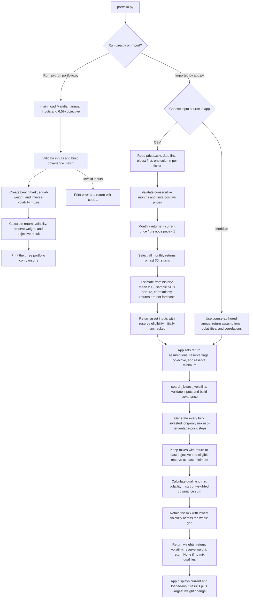

# FIN 439 — Portfolio Optimization Process

This process describes the functions in `portfolio.py` used by `app.py`. Built with AI help, a learning demonstration, not investment advice.

## Mermaid Flowchart



Running `python portfolio.py` prints only the existing three comparisons. CSV estimation and grid search run when called by the app or another importer. The app handles editing and display; the portfolio calculations stay in `portfolio.py`. Invalid CSV or search inputs raise an error that the app displays.

## Explanation of Each Step

### 1. Load Historical Prices
- Import `prices.csv`.
- Date in first column, followed by one column per ticker.
- Prices ordered oldest to newest.
- Use adjusted closing prices consistently across assets.

### 2. Validate Data
- Check for missing values and require finite, positive prices.
- Confirm unique dates in ascending order.
- Confirm exactly one observation per consecutive month.

### 3. Calculate Monthly Returns
- Monthly return = current price / previous price − 1.
- The first price row has no return; 61 monthly price rows produce 60 monthly returns.

### 4. Select Historical Window
- Use all available monthly returns.
- Or select the most recent 36 monthly returns, requiring at least 37 price rows.

### 5. Estimate Annual Inputs
- Historical annualized arithmetic return estimate = mean monthly return × 12.
- Annualized volatility estimate = sample monthly standard deviation × √12.
- Calculate correlations between assets using the same selected return window.
- Historical averages describe the sample and are not forecasts.

### 6. Set Optimization Inputs
- Choose editable annual return assumptions, initially populated from the historical estimates for CSV data.
- Identify reserve-eligible assets. Uploaded tickers start unchecked; Meridian's Treasury bills and 10-year note start checked.
- Set annual return objective (default 6.5%).
- Set minimum reserve allocation (default 3%).
- Meridian mode uses the course-authored annual inputs instead of CSV estimates.

### 7. Generate Portfolio Combinations
- Fully invested portfolio.
- Long-only positions.
- Weights in increments of 5 percentage points.
- Total portfolio weight equals 100%.

### 8. Apply Constraints
- Portfolio return under input assumptions = sum of each asset's weight × its return assumption.
- Portfolio return under input assumptions ≥ required objective.
- Reserve-eligible allocation ≥ minimum.

### 9. Calculate Portfolio Volatility
- Annual covariance between assets i and j = correlation(i, j) × annual volatility(i) × annual volatility(j).
- Portfolio volatility = √(w′Σw), where w is the weight vector and Σ is the annual covariance matrix.

### 10. Select the Lowest-Risk Grid Portfolio
- Identify the qualifying portfolio with the lowest estimated volatility among all tested mixes.
- Report asset weights, annual return under input assumptions, annualized volatility, and reserve-eligible allocation.
- Report “no mix meets the objective” if no portfolio qualifies under both constraints.
- This is the best mix on the 5-percentage-point grid; it is not a continuous optimization result or proof of full mandate compliance.

## App Comparison

The app displays the edited-input result beside the result for the inputs as loaded, using the same sidebar objective and reserve minimum. The CSV baseline always uses all monthly returns and its original reserve flags (all unchecked). It reports the largest absolute weight change in percentage points when both results are feasible.

`meridian_portfolio.py` is a separate script: it downloads Yahoo Finance data and uses continuous SLSQP optimization rather than the 5-point grid described here.


## Uploaded CSV: all months versus last 36 months

Used `prices.csv` with SPY, VXUS, BND, and SGOV. The annual return objective stayed at **6.50%** in both runs. The reserve minimum was **0%**, with all reserve checkboxes unchecked; this comparison imposes no reserve requirement and does not claim full Meridian mandate compliance. The app searched fully invested, long-only mixes in 5-percentage-point steps. Return assumptions were left at the historical estimates for each selected window, not edited to obtain feasibility.

The CSV has 61 month-end prices from September 2021 through September 2026. All months uses 60 monthly returns (October 2021–September 2026); the shorter window uses 36 monthly returns (October 2023–September 2026).

| Run | SPY | VXUS | BND | SGOV | Annual return under historical input assumptions | Annualized volatility | Eligible reserve |
| --- | ---: | ---: | ---: | ---: | ---: | ---: | ---: |
| All months | 25.00% | 5.00% | 0.00% | 70.00% | 6.63% | 4.62% | 0.00% |
| Last 36 months | 5.00% | 10.00% | 0.00% | 85.00% | 6.76% | 1.71% | 0.00% |

Largest weight change: SPY -20.00 percentage points (current minus loaded).

These results were read from the Streamlit app using its test runner with `prices.csv` supplied to the upload control. The last-36-month result is compared with the all-month loaded baseline. Historical averages are not forecasts; changing the sample changes the return assumptions, volatilities, and correlations together.

### Question from a line of code

From `portfolio.py`:

```python
means = returns.mean() * 12
```

**Question:** Why does this line calculate an annualized arithmetic historical return estimate rather than a five-year compound annual growth rate or a forecast of next year's return?
